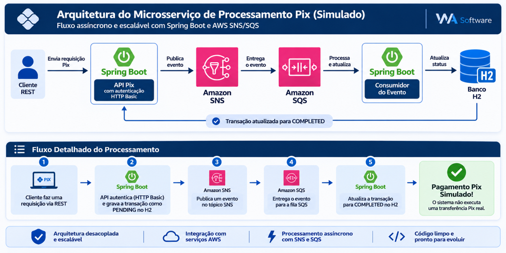

# Microsservico de processamento Pix



Aplicacao REST em Java 21 e Spring Boot que recebe solicitacoes Pix, persiste
uma transacao no banco H2 e publica o evento no AWS SNS. Um consumidor AWS SQS
pode receber o evento e atualizar o status da transacao para `COMPLETED`.

> O processamento de pagamento e simulado. Este projeto nao se conecta ao
> sistema financeiro nem inicia uma transferencia Pix real.

## Tecnologias

- Java 21 e Spring Boot 3.2.5
- Spring Web, Spring Security e Spring Data JPA
- H2 em memoria
- AWS SDK v2 SNS e Spring Cloud AWS SQS
- Maven Wrapper

## Estrutura

```text
src/
  main/
    java/wasoftware/microsservicosimulaoprocessamento/
      config/       configuracao de clientes AWS
      controller/  endpoints REST
      dto/         formato de entrada da API e validacoes
      entity/      entidade persistida pelo JPA
      enums/       estados da transacao
        messaging/ publicacao SNS e consumo SQS
      repository/  acesso aos dados
      security/    autenticacao e autorizacao HTTP
      service/     regras de negocio do Pix
    resources/
      application.properties
  test/             testes automatizados
```

## Requisitos

- JDK 21
- Uma conta AWS configurada pelo mecanismo padrao de credenciais do AWS SDK
  (por exemplo, variaveis `AWS_ACCESS_KEY_ID` e `AWS_SECRET_ACCESS_KEY`, ou um
  perfil AWS local)
- Um topico SNS e uma fila SQS configurados; a fila deve receber as mensagens
  do topico SNS

Defina as seguintes variaveis de ambiente antes de iniciar:

| Variavel | Descricao |
| --- | --- |
| `APP_SECURITY_USER` | Usuario HTTP Basic da API |
| `APP_SECURITY_PASS` | Senha HTTP Basic da API |
| `AWS_REGION` | Regiao AWS, por exemplo `us-east-1` |
| `AWS_SNS_PIX_TOPIC_ARN` | ARN do topico SNS de eventos Pix |
| `AWS_SQS_PIX_QUEUE_NAME` | Nome ou URL da fila SQS de eventos Pix |

O cliente SNS usa o provedor padrao de credenciais do AWS SDK. Para LocalStack,
`AWS_SNS_ENDPOINT` pode apontar para o endpoint SNS local.

## Executar

No PowerShell:

```powershell
$env:APP_SECURITY_USER = "seu-usuario"
$env:APP_SECURITY_PASS = "uma-senha-segura"
$env:AWS_REGION = "us-east-1"
$env:AWS_SNS_PIX_TOPIC_ARN = "arn:aws:sns:us-east-1:123456789012:pix"
$env:AWS_SQS_PIX_QUEUE_NAME = "pix-queue"
.\mvnw.cmd spring-boot:run
```

Para compilar e executar os testes:

```powershell
.\mvnw.cmd test
```

O banco H2 e mantido em memoria e reinicia vazio a cada execucao. O console H2
fica disponivel em `/h2-console`.

## API

`POST /api/v1/pix` exige autenticacao HTTP Basic e o header `Idempotency-Key`.
Envie uma chave unica por operacao; a chave fica associada a transacao:

```json
{
  "chavePix": "chave-destino",
  "valor": 25.90
}
```

O valor deve ser maior que zero e a chave Pix nao pode estar vazia. Repetir,
apos a primeira solicitacao ser registrada, a requisicao com a mesma chave e
os mesmos dados retorna a transacao existente, sem salvar outra transacao nem
publicar outro evento. Reutilizar a chave com dados diferentes retorna HTTP
`409 Conflict`. Em caso de sucesso, a API responde com HTTP `201 Created` e os
dados da transacao. Se duas primeiras solicitacoes com a mesma chave chegarem
simultaneamente, uma delas ainda pode falhar devido a uma disputa no banco.
O status inicial e `PENDING`; apos o consumidor processar uma mensagem da fila,
o status passa para `COMPLETED`.

Exemplo de chamada:

```powershell
curl.exe -u "$env:APP_SECURITY_USER`:$env:APP_SECURITY_PASS" `
  -H "Idempotency-Key: pedido-123" `
  -H "Content-Type: application/json" `
  -d '{"chavePix":"chave-destino","valor":25.90}' `
  http://localhost:8080/api/v1/pix
```
